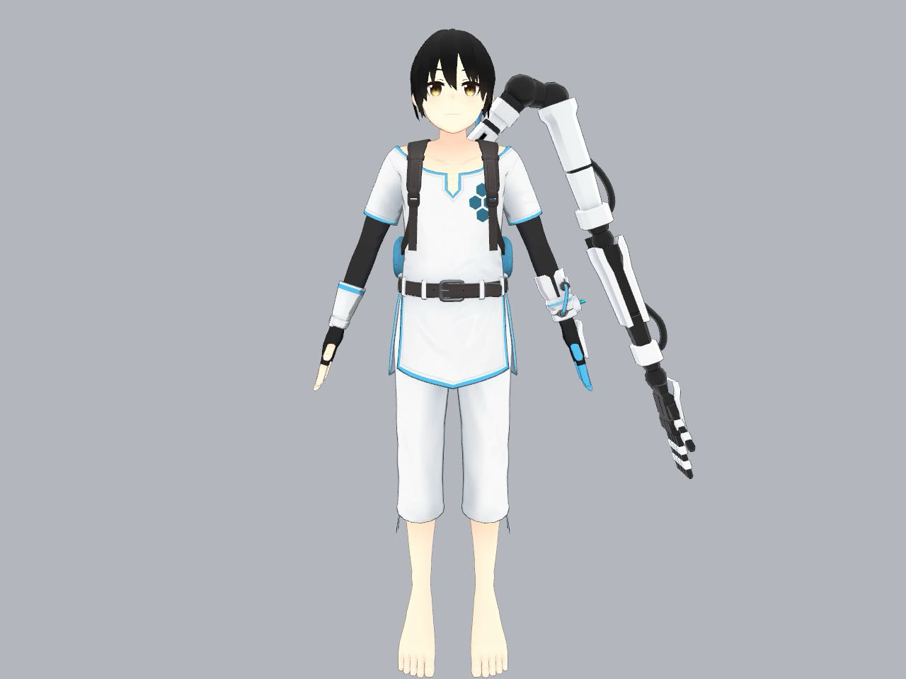

# hikari vrm

hikari vrm draws a vrm 1.0 model and streams the frames over http or shows it in its own window. i built it to be as light weight as possible without sacrificing speed or quality. it runs on metal on mac and vulkan on windows and linux.

Seed-san © VirtualCast, Inc., under the [vrm public license 1.0](https://vrm.dev/licenses/1.0/).

[getting started](docs/getting-started.md) has setup, running it and the http api.

## changes

- no browser or game engine. it draws straight on metal (mac) or vulkan (windows/linux), so the whole thing is 2.3 MB.
- every window/stream showing the same model shares one gpu copy of its textures and meshes (266 → 79 MB of gpu memory on Seed-san).
- one engine per model draws every stream size. a size only gets its own render target once something asks for it, and loses it after 10 s with nobody reading (79 → 67 MB).
- the loader drops its own copy of the meshes once they're on the gpu.
- the vrm loader, expressions, look-at, constraints and spring bones are plain rust with no dependencies.

## numbers

### against vcam

all three ran one at a time in the same session on an m6 mac, each in an 800x450 window with Seed-san idle and no camera or mic tracking. each number is the mean of two 30 second runs.

| Seed-san | vcam | hikari vrm | hikari vrm uses |
|---|---|---|---|
| memory | 606 MB | 167 MB | 72% less |
| peak memory | 611 MB | 189 MB | 69% less |
| gpu memory | 156 MB | 67 MB | 57% less |
| cpu | 22.7% | 2.1% | 91% less |

vcam draws its whole app around the model, and each idles with its own motion.

### against three-vrm

three-vrm 3.5.5 in chrome, same session, same model and window size.

| Seed-san | three-vrm | hikari vrm | hikari vrm uses |
|---|---|---|---|
| memory | 382 MB | 167 MB | 56% less |
| peak memory | 448 MB | 189 MB | 58% less |
| gpu memory | 77 MB | 67 MB | 12% less |
| cpu | 28.9% | 2.1% | 93% less |

the hikari vrm binary is 2.3 MB, against 306 MB for vcam and 1.5 GB for chrome plus three-vrm.

### quality

against three-vrm's own frames, frames differ by 0.4 to 1.2 out of 255 on average, across 8 poses on two sample models. the mac and windows builds differ from each other by about 0.1.

## licensing

my code is under the mit license (see `LICENSE`), and stb_image, syphon and the vulkan headers in `native/engine/` keep their own. the release zip copies every notice into `licenses/`. models aren't included, and each has its own terms in its vrm meta, so check them before you use one.
